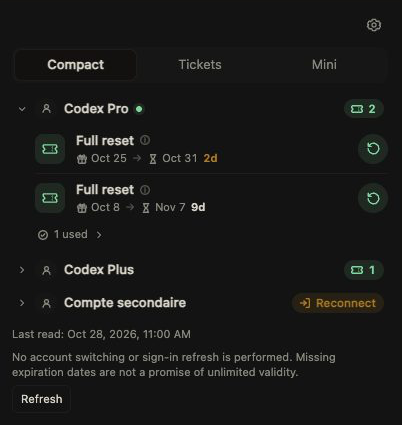
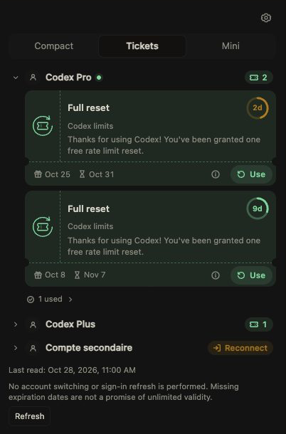

<p align="center">
  
</p>

# Codex resets for OpenChamber

**See your ChatGPT accounts’ Codex reset credits. Use one only when you choose.**

A rail panel and a small **Work Status** section for the ChatGPT accounts already
connected in OpenCode. No account switching, extra sign-in or automatic redemption.

[Website](https://sofianbll.github.io/openchamber-codex-reset-credits/) ·
[Install](docs/installation.md) · [Usage](docs/usage.md) ·
[Français](https://sofianbll.github.io/openchamber-codex-reset-credits/fr/)



*Public screenshots use synthetic preview data, not personal accounts or tokens.*

## Your credits, in context

- **Read every connected account.** See its OpenCode label, selected state and
  available resets. Open credit details for status, description and dates. Missing
  availability is not zero; a missing expiry is not unlimited validity.
- **Choose the view.** Compact, Tickets and Mini are available in the full panel
  and Work Status. Mini keeps account tickets visible; Compact and Tickets let
  you collapse accounts. Labels follow OpenChamber’s English or French locale.
- **Keep the sidebar small.** The panel’s gear controls the sidebar view, default
  panel view, whether Mini shows unavailable accounts, and the maximum sidebar
  account count. Leave the count blank to show all.
- **See what matters first.** The sidebar puts the selected readable account
  first, then accounts with available resets, readable accounts without resets,
  and unavailable accounts. Its limit applies after filtering and sorting;
  **+N others** reveals the rest. These preferences do not filter or reorder the
  full panel. A summary at the top of the section totals readable credits
  independently of the sidebar limit and flags incomplete totals and hidden
  unavailable accounts.
- **Confirm before using.** An inline confirmation names the account and credit.
  The service checks availability again before sending a consumption request.
  Expired, used and unknown-status credits cannot be redeemed.



[Display settings](docs/public/screenshots/panel-settings.png) ·
[Mini sidebar](docs/public/screenshots/sidebar-mini.png) ·
[Sidebar summary](docs/public/screenshots/sidebar-summary.png)

## Install from GitHub

Requires **OpenChamber 2.5.0+** on desktop or web, **OpenCode 2** with ChatGPT OAuth
accounts in its default local database, and **`sqlite3` on the OpenChamber host**.
macOS includes `sqlite3`; other hosts may need to install it.

1. Open **Settings → Extensions → Add extension** in OpenChamber.
2. Paste this repository URL:

   ```text
   https://github.com/sofianbll/openchamber-codex-reset-credits
   ```

3. Review and allow the **host service** capability, including `sqlite3` execution,
   then enable **Codex resets**.
4. Open **Codex resets** in the rail or expand its section in **Work Status**.
   Work Status’s section controls let you hide and reorder it.

The compiled panel and service ship with the extension; users do not need Bun or
a build step. Git is needed for URL installation. Append **`#v0.1.0`** to pin that
release once published. Alternatively, download the prebuilt archive and published
SHA-256 from [Releases](https://github.com/sofianbll/openchamber-codex-reset-credits/releases),
verify it, extract it into a permanent folder and install that folder.

[Installation, updates and archive verification](docs/installation.md).

## Privacy & safety

The service uses `sqlite3 -readonly` to select only OpenAI OAuth access tokens and
account metadata from `~/.local/share/opencode/opencode.db`. It does **not** select
refresh tokens, API keys or MCP credentials. Tokens remain inside the service;
the panel receives account labels/IDs, credit metadata and bounded error codes.

Requests go to fixed HTTPS ChatGPT endpoints, with redirects rejected. There are
no database writes, sign-in refreshes, account switches or automatic consumption.
The authenticated listener binds to `127.0.0.1`. The host service runs with your
user’s permissions: **it is not an OS sandbox**.

**Consumption cannot be undone and is never automatically retried.** A lost or
unrecognized response is an **uncertain result**, not a failed redemption. The
service locks that credit against another attempt for its remaining lifetime.
Refresh and check the account’s usage on ChatGPT; **do not retry**. Locks are
memory-only: restarting or pausing the extension clears them, not the uncertainty.
An HTTP 200 alone is not treated as proof that a reset succeeded.

ChatGPT’s reset endpoints are internal and may change. Only the default local
OpenCode 2 credential schema is supported; remote OpenCode servers, custom database
paths, V1 `auth.json`, VS Code and mobile hosting are outside this version’s scope.
This does not modify Settings → Providers or replace OpenChamber’s usage display.
No live credit consumption has been verified.

[Privacy and safety](docs/privacy.md) · [Troubleshooting](docs/troubleshooting.md)

## Uninstall

Disable or remove the extension in **Settings → Extensions**. No account migration
or OpenCode rollback is needed. Do not delete your source checkout as part of
uninstalling a folder-based development install. Removing the extension cannot
undo a consumed credit.

## Develop

```sh
bun install --frozen-lockfile
bun test
bun run typecheck
bun run build
bun run preview
bun run package /absolute/path/to/new/openchamber-codex-reset-credits-0.1.0
bun run docs:dev
```

The preview uses isolated, synthetic data: it cannot read OpenCode accounts or
consume real credits. Rebuild after source edits and reload the extension; restart
its service after service changes. `bun run docs:build` builds this mini-doc.

[Development and compatibility](docs/development.md) ·
[Contributing](CONTRIBUTING.md)

## License & credits

[MIT](LICENSE). Independent community extension, not affiliated with OpenAI or an
official OpenChamber release. Built with the
[OpenChamber SDK](https://github.com/openchamber/openchamber).
The internal API request format was informed by
[nexxai/opencode-codex-rate-limit-reset](https://github.com/nexxai/opencode-codex-rate-limit-reset).
